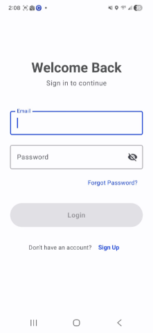
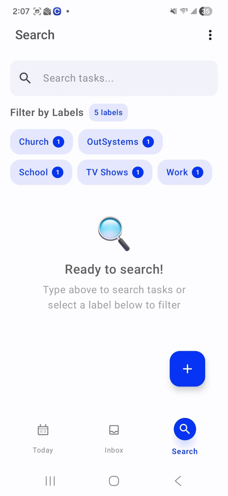
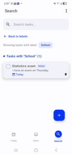
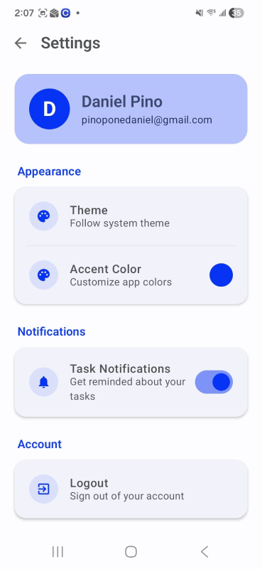

# Tadu — Smart Task Management App


An Android task manager built with Kotlin and Jetpack Compose, following an MVVM
architecture with a repository layer over Firebase (auth + cloud storage) and a local
Room database for offline-first persistence. Tasks support deadlines, priority levels,
labels, and location tags, with scheduled reminders backed by `AlarmManager` and a
`BroadcastReceiver` that survive a device reboot.

<table>
<tr>
<td width="25%"><br><sub>Login / registration</sub></td>
<td width="25%"><br><sub>Today — grouped by due date</sub></td>
<td width="25%"><br><sub>Task detail — location, reminder</sub></td>
<td width="25%"><br><sub>Calendar view</sub></td>
</tr>
<tr>
<td width="25%"><br><sub>Search / label filter</sub></td>
<td width="25%"><br><sub>Filtered by label</sub></td>
<td width="25%"><br><sub>Task history</sub></td>
<td width="25%"><br><sub>Settings</sub></td>
</tr>
</table>

---

## Features

- **Authentication** — sign up, log in, log out, delete account (Firebase Auth)
- **Cloud + local storage** — tasks sync to Firebase Cloud Storage and persist locally
  via Room for offline-first access
- **Reminders** — scheduled notifications via `AlarmManager` + `BroadcastReceiver`,
  automatically rescheduled on device reboot (`BootReceiver`)
- **Deadlines & priority** — due dates, priority levels, and custom labels
- **Location tagging** — attach a location to a task
- **Search & filtering** — search tasks by title or filter by label
- **Calendar view** — tasks laid out by date, with add-to-device-calendar support
- **Task history** — review past/completed tasks

---

## Architecture

- **MVVM** — `TaskViewModel` and `AuthViewModel` expose state to Compose screens; no UI
  code talks to Room or Firebase directly.
- **Repository layer** — `TaskRepository` and `UserRepository` are the single source of
  truth, deciding local (Room) vs. remote (Firebase) reads/writes.
- **Offline-first** — the local Room database is the primary read path; cloud sync goes
  through the repository layer rather than the UI.
- **Reminder scheduling** — `AndroidReminderScheduler` schedules `AlarmManager` alarms;
  `ReminderReceiver` handles firing them and `BootReceiver` re-schedules pending
  reminders after a device restart, since `AlarmManager` alarms don't survive a reboot
  on their own.

---

## Tech Stack

- Kotlin / Android SDK
- Jetpack Compose
- Firebase Authentication & Cloud Storage
- Room Persistence Library
- AlarmManager + BroadcastReceiver (task reminders)

---

## Installation

### 1. Clone the repository

```bash
git clone https://github.com/Daniel-Pino-2000/Tadu.git
```

### 2. Open in Android Studio

Open the cloned folder as an existing project and let Gradle sync.

### 3. Add your own Firebase config

Tadu needs a Firebase project (Authentication + Firestore enabled) to run. Create one in the
[Firebase console](https://console.firebase.google.com/), register an Android app with package
name `com.myapp.tadu`, download the generated `google-services.json`, and place it at
`app/google-services.json`, replacing the one already in this repo.

### 4. Run

Run the `app` configuration on an emulator or device (minSdk per `app/build.gradle.kts`).
