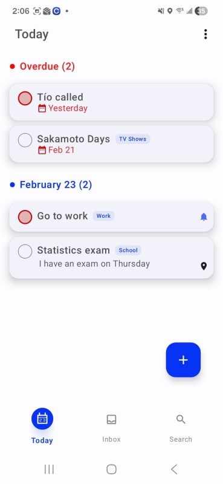
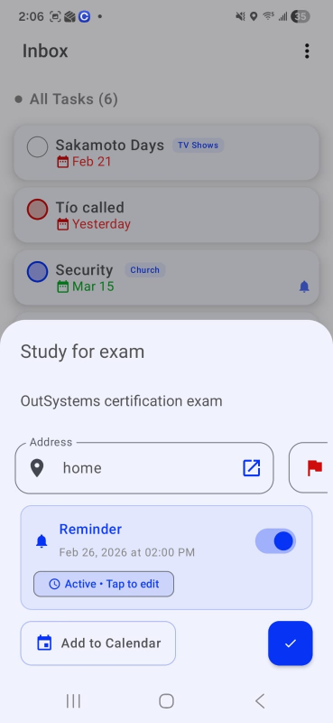
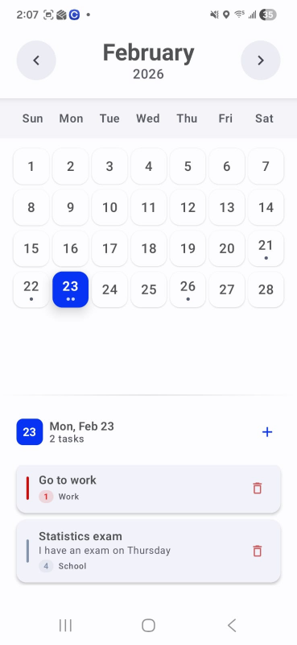
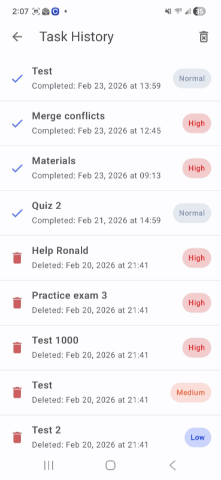

# Tadu — Smart Task Management for Android

[](https://github.com/Daniel-Pino-2000/Tadu/actions/workflows/ci.yml)


Tadu is an offline-first Android task manager built with Kotlin and Jetpack Compose.
Tasks live in a local Room database and sync to Firebase Firestore, so the app stays
responsive without a network connection. Tasks support deadlines, priorities, labels,
location tags, and scheduled reminders that survive a device reboot.

<table>
<tr>
<td width="25%"><br><sub>Login / registration</sub></td>
<td width="25%"><br><sub>Today — grouped by due date</sub></td>
<td width="25%"><br><sub>Task detail — location, reminder</sub></td>
<td width="25%"><br><sub>Calendar view</sub></td>
</tr>
<tr>
<td width="25%"><br><sub>Search / label filter</sub></td>
<td width="25%"><br><sub>Filtered by label</sub></td>
<td width="25%"><br><sub>Task history</sub></td>
<td width="25%"><br><sub>Settings</sub></td>
</tr>
</table>

---

## Highlights

- **Authentication** — email/password sign-up, login, logout, password reset, and
  account deletion with re-authentication (Firebase Auth).
- **Offline-first storage** — Room is the primary read path; changes are mirrored to
  Firestore under the signed-in user's document.
- **Reminders** — `AlarmManager` alarms fire through a `BroadcastReceiver`; pending
  reminders are rescheduled after a reboot by `BootReceiver`.
- **Organisation** — due dates, deadlines, priority levels, custom labels, and an
  optional location tag per task.
- **Views** — Today, Inbox, Search, Calendar, Reminders, History, and Settings.
- **Calendar integration** — add a task to the device calendar through an `INSERT`
  intent.
- **Personalisation** — light/dark/system theme, accent palettes, and a global
  notification toggle backed by DataStore.

## Tech stack

| Area | Choice |
| --- | --- |
| Language | Kotlin 2.0 |
| UI | Jetpack Compose (Material 2 + Material 3), Navigation Compose |
| Architecture | MVVM + repository layer, manual dependency container (`Graph`) |
| Local persistence | Room (KSP), DataStore Preferences |
| Backend | Firebase Authentication + Cloud Firestore |
| Background work | `AlarmManager`, `BroadcastReceiver` |
| Build | Gradle 8.11, AGP 8.10, version catalog (`gradle/libs.versions.toml`) |

## Architecture

```
Compose UI ──► ViewModels ──► Repositories ──┬──► Room (local, source of truth)
                                             └──► Firestore (per-user cloud copy)

ViewModels ──► ReminderScheduler ──► AlarmManager ──► ReminderReceiver ──► Notification
BootReceiver ──► ReminderScheduler (reschedule after reboot)
```

- The UI never talks to Room or Firebase directly; it observes state from ViewModels.
- `TaskRepository` decides when to touch the local database and when to mirror a
  change to Firestore.
- Reminder scheduling is behind the `ReminderScheduler` interface so it can be faked
  in tests.

Read [docs/ARCHITECTURE.md](docs/ARCHITECTURE.md) for the package map, data flows, and
known technical debt.

## Project structure

```
app/src/main/java/com/myapp/tadu/
├── data/                 Room entity, DAO, database, TaskRepository
│   └── remote/           Firebase Auth/Firestore services and result types
├── navigation/           Route and screen definitions
├── notifications/        Alarm scheduling, receivers, notification helpers
├── screens/              Login, sign-up, forgot-password UI
├── settings/             DataStore-backed settings repository and ViewModel
├── ui/theme/             Compose theme, typography, dynamic colour
├── view_model/           AuthViewModel and TaskViewModel
├── Graph.kt              Manual dependency container
├── MainActivity.kt       Entry point and navigation host
└── *.kt                  Compose screens and shared components
```

## Getting started

### Prerequisites

- Android Studio Meerkat Feature Drop (2024.3.2) or newer, or the Android
  command-line tools
- JDK 17 (Android Studio's bundled JDK works)
- Android SDK 35
- A Firebase project with **Authentication** and **Cloud Firestore** enabled

### 1. Clone the repository

```bash
git clone https://github.com/Daniel-Pino-2000/Tadu.git
cd Tadu
```

### 2. Connect your own Firebase project

The repository does **not** ship a real Firebase configuration.

1. Create a project in the [Firebase console](https://console.firebase.google.com/).
2. Add an Android app with package name `com.myapp.tadu`.
3. Enable the **Email/Password** sign-in provider.
4. Create a **Firestore Database** (production mode is fine).
5. Download `google-services.json` and place it at `app/google-services.json`.
6. Deploy the included security rules (requires the Firebase CLI):

   ```bash
   firebase deploy --only firestore:rules
   ```

`app/google-services.json` is git-ignored. If you only need to compile the project
without a real backend, copy the placeholder instead:

```bash
cp app/google-services.json.example app/google-services.json
```

### 3. Build and run

```bash
./gradlew assembleDebug        # build the debug APK
./gradlew installDebug         # install on a connected device/emulator
```

Or open the folder in Android Studio and run the `app` configuration.

## Build, test and quality checks

| Command | Purpose |
| --- | --- |
| `./gradlew assembleDebug` | Compile and package the debug APK |
| `./gradlew testDebugUnitTest` | Run JVM unit tests |
| `./gradlew lintDebug` | Run Android Lint |
| `./gradlew connectedDebugAndroidTest` | Run instrumentation tests (device required) |
| `./gradlew assembleRelease` | Build a minified release APK/AAB |
| `./gradlew clean` | Delete build outputs |

CI runs lint, unit tests, and a debug build on every push and pull request. See
[docs/DEVELOPMENT.md](docs/DEVELOPMENT.md) for release signing and troubleshooting.

## Documentation

- [Architecture](docs/ARCHITECTURE.md) — layers, data flows, Firestore schema, debt
- [Development guide](docs/DEVELOPMENT.md) — setup, commands, CI, releases
- [Contributing](CONTRIBUTING.md) — workflow, conventions, pull requests
- [Code of Conduct](CODE_OF_CONDUCT.md)
- [Security policy](SECURITY.md)
- [Changelog](CHANGELOG.md)
- [Agent / house rules](AGENTS.md) — conventions for AI-assisted and human changes

## Contributing

Contributions are welcome. Please read [CONTRIBUTING.md](CONTRIBUTING.md) and the
[Code of Conduct](CODE_OF_CONDUCT.md) before opening a pull request. Use the issue
templates for bugs and feature requests.

## Security

Please do not open public issues for security problems. See [SECURITY.md](SECURITY.md)
for the reporting process and the project's secrets policy.

## License

No license has been chosen yet. Until a `LICENSE` file is added, the code is
all rights reserved. If you intend to accept outside contributions or allow reuse,
add a license (MIT and Apache-2.0 are common choices for Android projects).
