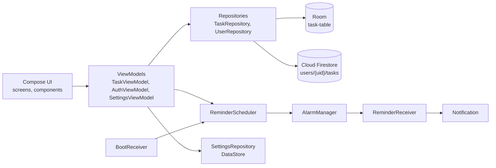

# Architecture

Tadu is a single-module Android app that follows MVVM with a repository layer. The
local Room database is the primary source of truth for reads; Firestore holds a
per-user cloud copy that is pulled on sign-in and updated on writes.

## Layers



| Layer | Responsibility | Key types |
| --- | --- | --- |
| UI | Render state, forward user events | `MainActivity`, `HomeView`, `BottomNavScreens`, `AddTaskSpecifics`, `TaskCalendarView`, `TaskHistoryView`, `TaskReminderView`, `TaskSettingsView` |
| Presentation | Hold screen state, orchestrate use cases | `TaskViewModel`, `AuthViewModel`, `SettingsViewModel` |
| Domain/data | Read/write tasks, decide local vs. remote | `TaskRepository`, `UserRepository`, `TaskCloudService` |
| Persistence | Local database and preferences | `TaskDatabase`, `TaskDao`, `SettingsRepository` |
| Platform | Alarms, notifications, boot handling | `AndroidReminderScheduler`, `ReminderReceiver`, `BootReceiver` |

Dependencies are wired manually in `Graph` (application-scoped database, repository,
and scheduler) and through ViewModel factories. There is no DI framework; the graph is
small enough that adding one is optional.

## Data flows

### App start and authentication

1. `TaskListApp.onCreate()` creates the notification channel and calls
   `Graph.provide(context)`.
2. `MainActivity` observes the Firebase auth state through `AuthViewModel`.
3. When a user is present, `MainActivity` calls `TaskRepository.syncFromCloud()`,
   which reads `users/{uid}/tasks` from Firestore and upserts each document into Room.
4. On logout or account deletion, `TaskRepository.clearLocalTasks()` wipes the local
   task table so the next user starts clean.

### Task writes

`TaskViewModel` launches repository calls on `Dispatchers.IO`. `TaskRepository`
performs the Room operation first, then mirrors the resulting task to Firestore via
`TaskCloudService.saveTask()` (or `deleteTask()` for hard deletes). Reminder
scheduling is handled by the ViewModel around those calls.

### Task reads

Room exposes `Flow<List<Task>>` queries for pending, completed, deleted, finished,
reminder, label, and per-id views. ViewModels expose those flows directly and Compose
collects them, so database changes recompose the UI automatically.

### Reminders

1. `TaskViewModel.addTask` / `updateTask` / `restoreTask` call
   `ReminderScheduler.schedule(task)` when `reminderTime` is in the future.
2. `AndroidReminderScheduler` checks the DataStore notification toggle and the
   `POST_NOTIFICATIONS` permission, then schedules an exact alarm (falling back to an
   inexact alarm when exact alarms are not permitted).
3. The `PendingIntent` request code is `task.id.toInt()`, so a task's alarm can be
   replaced or cancelled deterministically.
4. `ReminderReceiver` builds and posts the notification; `BootReceiver` re-schedules
   pending reminders after `BOOT_COMPLETED`.

## Data model

`Task` is a Room entity stored in the `task-table` table. Column names use kebab-case
and are quoted in DAO queries.

| Field | Type | Notes |
| --- | --- | --- |
| `id` | `Long` | Primary key, auto-generated by Room; used as the Firestore document ID |
| `title`, `description` | `String` | Free text |
| `date` | `Long` | Creation timestamp (epoch millis) |
| `address` | `String` | Optional location tag |
| `priority` | `String` | Priority level, interpreted by `PriorityUtils` |
| `deadline` | `String` | Display deadline |
| `isDeleted`, `deletionDate` | `Boolean`, `Long?` | Soft-delete state |
| `isCompleted`, `completionDate` | `Boolean`, `Long?` | Completion state |
| `label` | `String` | User-defined label |
| `reminderTime` | `Long?` | Epoch millis for the alarm |
| `reminderText` | `String?` | Custom reminder text |

### Firestore layout

```
users/{uid}                         User profile (User model)
users/{uid}/tasks/{taskId}          Task document (Task model, id = taskId)
```

The included [`firestore.rules`](../firestore.rules) restrict every document to its
owning user. Deploy them with `firebase deploy --only firestore:rules`.

## Settings

`SettingsRepository` wraps a Preferences DataStore named `settings` and stores:

- `theme_mode` — `SYSTEM`, `LIGHT`, or `DARK`
- `accent_color_index` — palette index (never a raw colour)
- `notifications_enabled` — global reminder toggle

## Testing strategy

- **Unit tests** (`app/src/test`) target pure logic and repository/ViewModel behaviour
  using fakes for `TaskDao`, `TaskCloudService`, and `ReminderScheduler`.
- **Instrumentation tests** (`app/src/androidTest`) target Compose UI and device-only
  behaviour such as alarms and notifications.
- CI runs lint, JVM unit tests, and `assembleDebug`. Instrumentation tests require a
  device or emulator and are run locally.

## Key decisions

- **Room-first reads** — the UI never waits on the network to show data.
- **Write-through sync** — writes go local then remote. This keeps the common case
  simple, at the cost of no retry queue (see debt below).
- **Manual DI** — `Graph` and ViewModel factories keep the build simple for a
  single-module app.
- **AlarmManager for reminders** — reminders need exact, user-visible timing, so they
  are scheduled with `AlarmManager` rather than WorkManager.
- **Sealed `Screen` routes** — type-safe navigation destinations instead of raw strings
  at call sites.

## Known technical debt

These are deliberate starting points for future improvements, not blockers:

1. **Best-effort cloud sync.** Firestore writes are not queued or retried. A write made
   offline is only mirrored on the next successful repository call; there is no
   conflict resolution or `updatedAt` field. An outbox table plus WorkManager would
   make sync durable.
2. **Mutable `Task` model.** The entity uses `var` properties. Prefer immutable `val`
   properties with `copy()` to reduce accidental shared-state bugs.
3. **Full-pull sync.** `syncFromCloud()` upserts remote tasks but does not remove local
   tasks deleted remotely, and it has no tombstones. Add `updatedAt`/`deletedAt` and a
   merge strategy.
4. **Long task IDs derived from UUID bits.** IDs are generated with
   `UUID.randomUUID().mostSignificantBits and Long.MAX_VALUE`. Collisions are unlikely
   but not impossible; a string UUID would remove the risk.
5. **Unstructured coroutine scope.** `AndroidReminderScheduler` creates its own
   `CoroutineScope` per schedule call. Inject an application scope instead.
6. **Stubbed bulk cancel.** `cancelAllReminders()` only logs; track scheduled alarms or
   cancel by task list when notifications are disabled.
7. **Hardcoded strings.** Only `app_name` lives in `strings.xml`. Extract user-facing
   text for localisation and lint cleanliness.
8. **Material 2 and Material 3 coexist.** Plan a single design-system migration.
9. **Boilerplate tests.** `ExampleUnitTest` / `ExampleInstrumentedTest` are still
   generated samples; replace them with behaviour tests as features change.
10. **No release signing configuration.** Release builds are currently unsigned; see
    the development guide before publishing.
